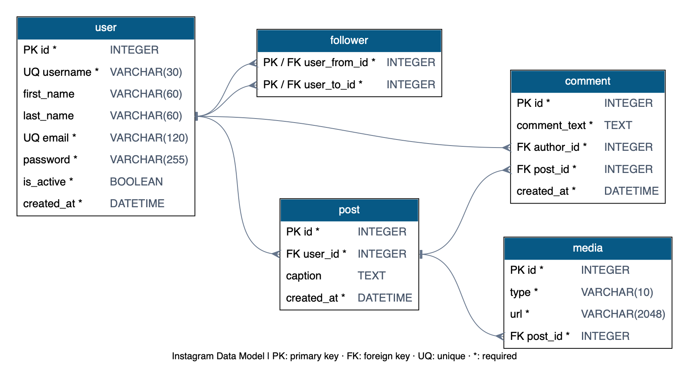

# Instagram Data Modeling

[English](README.md) · [Español](README.es.md) · [Português](README.pt.md)

SQLAlchemy data modeling exercise from 4Geeks Academy. The deliverable is five related models and an entity relationship diagram; no frontend or API implementation is required.

## Models

| Model | Purpose |
| --- | --- |
| User | Unique username and email, profile fields, password storage and activity status |
| Post | Publication caption, creation time and author |
| Media | Image or video URL belonging to a publication |
| Comment | Comment text, author and publication |
| Follower | Directed relationship between two users |

A user has many posts and comments. A post has many media items and comments. Followers connect users through two foreign keys; their composite primary key prevents duplicate follows, and a check constraint prevents self-following. Media accepts only `image` or `video`. Deleting a post through the ORM deletes its media and comments. Passwords are excluded from user serialization; an authentication implementation must hash passwords before storing them.

## Run locally

Requirements: Python 3.13, Pipenv and the native Graphviz executable (`dot`) on PATH. Installing the Python `graphviz` package alone does not install `dot`. On this Mac, Graphviz is already available in the project's Pipenv environment.

```bash
pipenv install
pipenv run diagram
pipenv run test
```

Alternatively, generate the diagram with `pipenv run python src/models.py`. The output is `diagram.png` in the project root. Diagram generation and tests do not require a running database server or an `.env` file. Tests use a real in-memory SQLite database with foreign keys enabled.



Diagram legend: PK = primary key, FK = foreign key, UQ = unique, * = required. Lines show one-to-many relationships. The media type check constraint and the self-follow check constraint are defined in `src/models.py`.

## Sources

The repository is a fork of the [official exercise](https://github.com/breatheco-de/exercise-instagram-data-modeling). The Flask starter files come from the school's [flask-rest-hello template](https://github.com/4GeeksAcademy/flask-rest-hello). The model follows the exercise's five-entity reference diagram. The template's existing API, deployment and migration files are retained; they are outside the modeling deliverable. No Codespace is needed.
